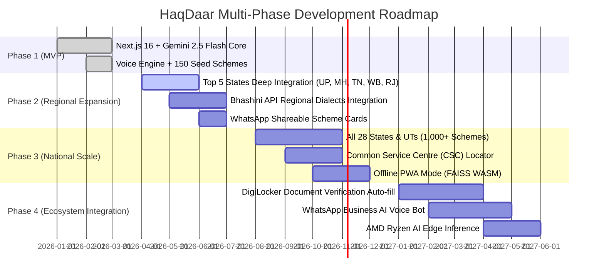

# HaqDaar (हक़दार) — Comprehensive Project Specification & Architectural Blueprint 🇮🇳

> **"Every Indian deserves to know what they are entitled to — in their own language, in their own voice."**  
> *"हर भारतीय का हक — उनकी भाषा में, उनकी आवाज़ में"*

---

## Executive Summary

| Attribute | Details |
|---|---|
| **Project Name** | **HaqDaar (हक़दार)** |
| **Current Version** | **v4.0.0 (Production Architecture)** |
| **Mission** | Democratize access to 1,000+ Indian central and state welfare schemes through conversational AI, multimodal voice processing, and real-time eligibility matching. |
| **Core Technology** | Next.js 16 (Turbopack, App Router) + React 19 + TypeScript + Google Gemini 2.5 Flash / Gemini Live + Neural TTS + Tailwind CSS v4 + Zustand |
| **Target Audience** | Low-literacy citizens, rural farmers, daily wage workers, first-generation students, single mothers, senior citizens, and marginalized communities across India. |
| **Delivery Model** | Zero-cost civic-tech platform; mobile-first Progressive Web App (PWA); zero-login intake; privacy-preserving on-device matching. |

---

## Table of Contents

1. [The Problem Statement & Opportunity](#1-the-problem-statement--opportunity)
2. [The Core Solution & Value Proposition (USP)](#2-the-core-solution--value-proposition-usp)
3. [User Personas & Practical Impact Stories](#3-user-personas--practical-impact-stories)
4. [Complete System Architecture](#4-complete-system-architecture)
5. [End-to-End User Journey & Process Flow](#5-end-to-end-user-journey--process-flow)
6. [Technology Stack & Architectural Decisions](#6-technology-stack--architectural-decisions)
7. [Voice Pipeline & Multimodal Processing](#7-voice-pipeline--multimodal-processing)
8. [Hybrid Scheme Matching & RAG Engine](#8-hybrid-scheme-matching--rag-engine)
9. [API Surface & Data Schemas](#9-api-surface--data-schemas)
10. [Hardware Optimization & Infrastructure (AMD & Cloud)](#10-hardware-optimization--infrastructure-amd--cloud)
11. [Security, Privacy & Rate Limiting](#11-security-privacy--rate-limiting)
12. [Financial Model & Implementation Costs](#12-financial-model--implementation-costs)
13. [Project Directory & File Structure](#13-project-directory--file-structure)
14. [Multi-Phase Roadmap & Future Enhancements](#14-multi-phase-roadmap--future-enhancements)

---

## 1. The Problem Statement & Opportunity

### The Indian Welfare Paradox
The Government of India and various State administrations allocate **hundreds of thousands of crores of rupees** each year across more than **1,000 welfare schemes, subsidies, scholarships, and social safety nets**. 

Despite this massive allocation, millions of eligible citizens never claim their entitlements:
- **Language Barrier**: Scheme criteria, official guidelines, and application forms are predominantly hosted in formal English or bureaucratic state languages.
- **Fragmented Infrastructure**: Schemes are scattered across 50+ central ministries, state-level departments, and disparate portals (`myscheme.gov.in`, `scholarships.gov.in`, `pmkisan.gov.in`, state portals).
- **Form Fatigue & Complex Criteria**: Traditional search requires filling out long, confusing forms with dropdowns (annual household income thresholds, landholding limits, caste certifications, sub-districts).
- **Digital Literacy & Illiteracy**: Millions of daily-wage earners and rural citizens cannot navigate multi-step websites or read complex PDFs.
- **Intermediary Exploitation (Middlemen/Dalals)**: Citizens often pay bribes or hefty fees to intermediaries simply to understand whether they qualify or to obtain basic application forms.

```
+-------------------------------------------------------------------------+
|                         THE CURRENT BOTTLENECK                          |
|                                                                         |
|  Government Welfare               Bureaucratic              Excluded    |
|   (Lakhs of Crores)  -----------> PDF Maze &    -----------> Citizens   |
|   1,000+ Schemes                  50+ Portals                           |
|                                                                         |
|                         HAQDAAR AI INTERVENTION                         |
|                                                                         |
|  Government Welfare               HaqDaar AI                Empowered   |
|   (Central + State)  -----------> Voice & Chat  -----------> Citizens   |
|                                   Multilingual               (Direct)   |
+-------------------------------------------------------------------------+
```

---

## 2. The Core Solution & Value Proposition (USP)

HaqDaar eliminates every friction point between a citizen and their constitutional and welfare entitlements:

1. **"Talk, Don’t Fill Forms" (Natural Language Intake)**:
   Citizens simply describe their life situation in their own words (e.g., *"I have 2 acres in Gorakhpur and my daughter is studying in class 11"*).
2. **Push-to-Talk Multimodal Voice Interface**:
   Citizens tap a single button and speak. HaqDaar listens, transcribes vernacular dialects, extracts eligibility facts, and **speaks back** using warm, neural audio.
3. **Implicit Demographic Extraction**:
   Powered by Gemini 2.5 Flash, the conversational layer extracts demographic vectors (state, occupation, income, caste, age, landholding, BPL status) behind the scenes without demanding questionnaire submissions.
4. **Hybrid Eligibility Engine (Rule Filters + AI Ranking)**:
   Combines strict deterministic legal rules (age caps, income ceilings, domicile requirements) with semantic fuzzy matching and LLM re-ranking.
5. **Jargon-Free Action Plans**:
   Every matched scheme generates:
   - **Plain-language justification**: Exactly *why* the citizen qualifies.
   - **Quantified benefits**: Exact financial support, subsidy percentages, or insurance coverage.
   - **Document checklist**: Exact physical papers required (Aadhaar, Domicile certificate, Passbook).
   - **Step-by-step application pathway**: Online portal links or instructions for the nearest Common Service Centre (CSC) / Panchayat office.
6. **Privacy-First & Zero Friction**:
   No mandatory signup, phone number verification, or password creation required to discover schemes.

### Feature Comparison Matrix

| Capability | myscheme.gov.in | UMANG App | NGO Helplines | HaqDaar (हक़दार) |
|---|---|---|---|---|
| **Conversational Intake** | ❌ Form only | ❌ Form only | ⚠️ Phone call only | ✅ **Fluid Chat & Voice** |
| **Voice Input + Audio Output** | ❌ None | ⚠️ Basic TTS | ⚠️ Phone audio only | ✅ **Gemini Multimodal Voice + Neural TTS** |
| **Dialect & Vernacular Support** | ⚠️ English/Hindi | ⚠️ Limited | ⚠️ Operator dependent | ✅ **Hindi, Hinglish, English, Indic regional** |
| **Implicit Profile Extraction** | ❌ Manual | ❌ Manual | ⚠️ Manual note-taking | ✅ **AI-extracted silently** |
| **Plain-Language Translation** | ❌ Official policy text | ❌ Form guidelines | ⚠️ Varies | ✅ **Empathic, citizen-first explanation** |
| **Offline-Capable Matching** | ❌ Server-only | ❌ Server-only | ❌ No | ✅ **In-browser rule scoring + cache** |
| **Cost to Citizen** | Free | Free | Often paid or limited | ✅ **100% Free Forever** |

---

## 3. User Personas & Practical Impact Stories

```
 👩‍🎓 Priya (18, Uttar Pradesh)
   Situation : First-generation college student; parents are agricultural laborers.
   Problem   : Overwhelmed by 30+ Central & UP state scholarship portals.
   HaqDaar   : Priya speaks in Hindi; HaqDaar identifies UP Post-Matric Scholarship + 
               Free Tablet Scheme and lists required caste & income certificates.

 👨‍🌾 Ramesh (42, Bihar)
   Situation : Smallholder farmer with 1.5 acres; seasonal flood damage.
   Problem   : Cannot read English portal instructions; missed PM-KISAN eKYC deadlines.
   HaqDaar   : Ramesh uses Voice Assistant; receives audio instructions on PM-KISAN,
               Kisan Credit Card (KCC), and PM Fasal Bima Yojana.

 👩 Fatima (35, Telangana)
   Situation : Single mother working as a domestic helper with 2 school-going children.
   Problem   : Unaware of women-targeted social welfare and municipal schemes.
   HaqDaar   : Discovers Widow Pension, PM Ujjwala 2.0 (free LPG connection), and state 
               education subsidies in under 2 minutes.

 🧑‍🔧 Suresh (28, Mumbai)
   Situation : Daily-wage construction laborer; informal sector worker.
   Problem   : No health insurance or job security; unaware of government safety nets.
   HaqDaar   : Recommends Ayushman Bharat PM-JAY (₹5 Lakh cashless health cover) and 
               e-Shram portal registration for accident insurance.
```

---

## 4. Complete System Architecture

HaqDaar v4 is architected as a modular, decoupled modern web application with high performance, edge resilience, and low-latency audio processing.

```
┌────────────────────────────────────────────────────────────────────────────────────────┐
│                                CLIENT / BROWSER TIER                                   │
│                                                                                        │
│   Next.js 16 App Router (Turbopack) • React 19 • Tailwind CSS v4 • Framer Motion       │
│                                                                                        │
│   ┌────────────────────┐   ┌───────────────────────────┐   ┌────────────────────────┐  │
│   │   Voice Assistant  │   │     Conversational Chat   │   │    Schemes Directory   │  │
│   │   Push-to-Talk Mic │   │    Multi-turn Dialogue    │   │    Faceted Filtering   │  │
│   │   Audio Visualizer │   │    Profile Indicators     │   │    Fuse.js Fuzzy Find  │  │
│   └─────────┬──────────┘   └─────────────┬─────────────┘   └───────────┬────────────┘  │
│             │                            │                             │               │
│             │       Zustand Global State (AppStore, ChatStore, VoiceStore)             │
│             │       Web Audio API (Float32 PCM 24kHz) • LocalStorage Cache             │
└─────────────┼────────────────────────────┼─────────────────────────────┼───────────────┘
              │                            │                             │
              ▼                            ▼                             ▼
┌────────────────────────────────────────────────────────────────────────────────────────┐
│                              NEXT.JS SERVER / API ROUTE TIER                           │
│                                                                                        │
│   Rate Limiting (Token Bucket/Sliding Window) • Zod Validation • Security Headers      │
│                                                                                        │
│   ┌───────────────────┐  ┌───────────────────┐  ┌────────────────┐  ┌────────────────┐ │
│   │   /api/voice      │  │    /api/chat      │  │  /api/match    │  │  /api/explain  │ │
│   │ Audio Transcription│  │ Profile Extraction│  │ RAG Ranking    │  │ Plain-English  │ │
│   │ + Neural Speech   │  │ Multi-turn Buffer │  │ Candidate Pool │  │ Breakdown      │ │
│   └─────────┬─────────┘  └─────────┬─────────┘  └────────┬───────┘  └───────┬────────┘ │
│             │                      │                     │                  │          │
│             └──────────────────────┼─────────────────────┴──────────────────┘          │
│                                    │                                                   │
│                                    ▼                                                   │
│                        Gemini AI Client (@google/genai)                                │
│                     Automatic Exponential Backoff & Retry Logic                        │
└────────────────────────────────────┬───────────────────────────────────────────────────┘
                                     │
                                     ▼
┌────────────────────────────────────────────────────────────────────────────────────────┐
│                              AI & COGNITIVE SERVICES TIER                              │
│                                                                                        │
│   ┌───────────────────────────────┐         ┌──────────────────────────────────────┐   │
│   │      Gemini 2.5 Flash         │         │     Gemini 2.5 Flash Preview TTS     │   │
│   │  • Multimodal Audio Input     │         │  • Neural Voice Synthesis ("Kore")   │   │
│   │  • Structured Profile Extract │         │  • 24kHz High-Fidelity Audio Stream  │   │
│   │  • Multilingual Translation   │         │  • Hindi/English Vernacular Delivery │   │
│   └───────────────────────────────┘         └──────────────────────────────────────┘   │
└────────────────────────────────────┬───────────────────────────────────────────────────┘
                                     │
                                     ▼
┌────────────────────────────────────────────────────────────────────────────────────────┐
│                              DATA & MATCHING ENGINE TIER                               │
│                                                                                        │
│   ┌───────────────────────────────┐         ┌──────────────────────────────────────┐   │
│   │  Deterministic Rule Matcher   │         │     Scheme Knowledge Repository      │   │
│   │  • Domicile / State Filter    │         │  • 1,000+ Central & State Schemes    │   │
│   │  • Income Ceiling Filter      │         │  • Bilingual Metadata (HI / EN)      │   │
│   │  • Age / Gender / BPL Rules   │         │  • Eligibility Logic & Portals       │   │
│   │  • Dynamic Weight Scoring     │         │  • Document Checklist Taxonomy       │   │
│   └───────────────────────────────┘         └──────────────────────────────────────┘   │
└────────────────────────────────────────────────────────────────────────────────────────┘
```

---

## 5. End-to-End User Journey & Process Flow

```mermaid
sequenceDiagram
    autonumber
    actor Citizen as Indian Citizen
    participant UI as HaqDaar Frontend (React 19)
    participant VoiceHook as useVoiceSession Hook
    participant Server as Next.js API Layer
    participant Gemini as Google Gemini 2.5 Flash
    participant Matcher as Scheme Matching Engine

    Citizen->>UI: Lands on HaqDaar (Selects Hindi/English)
    Citizen->>UI: Clicks Mic button & describes situation in voice
    UI->>VoiceHook: Captures audio chunks via MediaRecorder (webm/opus)
    VoiceHook->>Server: POST /api/voice (Base64 audio + conversation history)
    Server->>Gemini: Multimodal audio payload + system extraction prompt
    Gemini-->>Server: JSON: { transcript, message, profile: {...}, ready_to_match }
    Server->>Gemini: Synthesize voice response (Gemini TTS: "Kore")
    Gemini-->>Server: 24kHz PCM Audio Base64
    Server-->>VoiceHook: Returns transcript, message, updated profile & audio
    VoiceHook->>UI: Plays neural speech via Web Audio API; prints conversation
    
    alt Profile has required fields (Occupation + State/Income)
        VoiceHook->>Matcher: Runs rule-based scoring + RAG candidate evaluation
        Matcher-->>UI: Generates ranked shortlist of matched schemes (Scores 0-99)
        Citizen->>UI: Views Matched Schemes card list
        Citizen->>Server: Clicks "Explain Scheme" (POST /api/explain)
        Server->>Gemini: Generates 4-point bulleted plain-language breakdown
        Gemini-->>UI: Displays exact qualification reasons, benefits & required documents
        Citizen->>UI: Clicks official portal link or follows CSC application steps
    else Incomplete profile
        VoiceHook->>UI: Asks friendly follow-up question (e.g., "Aap kis rajya se hain?")
    end
```

---

## 6. Technology Stack & Architectural Decisions

### 6.1 Frontend Stack
- **Framework**: **Next.js 16.4.0** with **Turbopack**
  - *Rationale*: Blazing-fast hot reloading during development; hybrid Static Site Generation (SSG) for static scheme directories with Server-Side Rendering (SSR) for secure API proxies.
- **Library**: **React 19.3.0**
  - *Rationale*: Modern hook primitives, efficient concurrent rendering, zero client hydration mismatch.
- **Styling**: **Tailwind CSS v4** + `@tailwindcss/turbopack`
  - *Rationale*: Zero runtime CSS overhead, modern OKLCH color spaces, custom design tokens, tricolor gradients.
- **State Management**: **Zustand 5.0.5**
  - *Rationale*: Lightweight, boilerplate-free state stores (`appStore.ts`, `chatStore.ts`, `voiceStore.ts`) with selective re-rendering and transparent localStorage synchronization.
- **Fuzzy Search**: **Fuse.js 7.1.0**
  - *Rationale*: Client-side instant multi-key fuzzy search across scheme titles, benefits, tags, and Hindi transliterations without round-trip network delays.
- **Animations**: **Framer Motion 12.6.3**
  - *Rationale*: Fluid spring physics for voice wave animations, page transitions, and expandable scheme cards.
- **Icons & Notifications**: **Lucide React** (`^0.487.0`) & **Sonner** (`^2.0.3`)

### 6.2 Backend & AI Stack
- **AI SDK**: **`@google/genai` (v2.23.0)**
  - *Rationale*: Official, unified Google Gen AI client library supporting multimodal text, audio, and live streaming sessions.
- **Foundation Model**: **Gemini 2.5 Flash** (`gemini-2.5-flash`)
  - *Rationale*: Sub-second latency, exceptional multilingual comprehension of Indian languages (Hindi, Bengali, Tamil, Telugu, Marathi, Gujarati, etc.), low token costs, native audio input capability.
- **Speech Synthesis (TTS)**: **Gemini 2.5 Flash Preview TTS** (`gemini-2.5-flash-preview-tts` voice `"Kore"`)
  - *Rationale*: Natural, empathetic prosody; seamless handling of Indian names, acronyms (PM-KISAN, SC/ST, EWS), and Hindi phonetics.
- **Validation**: **Zod 3.24.4**
  - *Rationale*: Runtime schema validation for all client-to-server payloads.

---

## 7. Voice Pipeline & Multimodal Processing

The voice architecture is one of HaqDaar’s premier engineering achievements. It implements a resilient multi-tier audio processing pipeline designed to operate even on low-spec smartphones and unstable 2G/3G connections.

```
                    VOICE PROCESSING LIFECYCLE
                    
   [ Citizen Speaks into Microphone ]
                 │
                 ▼
   MediaRecorder (WebM / Opus 250ms chunks)
                 │
                 ▼
   Base64 Audio Packaging + Conversation History Context
                 │
                 ▼
   POST /api/voice (Next.js Server API)
                 │
                 ▼
   Gemini 2.5 Flash Multimodal Ingestion (Audio Part + System Instruction)
                 │
                 ├───────────────────────────────┐
                 ▼                               ▼
       Transcribed Vernacular Text      Demographic Profile Extracted
                 │                               │
                 ▼                               ▼
       Gemini 2.5 Flash TTS            Zustand Store Merges State
      (Voice: "Kore", 24kHz PCM)                 │
                 │                               ▼
                 ▼                     Rule-based Eligibility Triggered
       Client Web Audio API                      │
     (PCM Float32Array Playback)                 ▼
                 │                     Schemes Displayed to Citizen
                 ▼
   [ Citizen Hears Audio Response ]
```

### Key Voice Features:
1. **Direct Audio Comprehension**:
   Instead of piping Audio ➔ Separate STT ➔ LLM ➔ Separate TTS (which introduces 3-4 seconds of compound latency), Gemini 2.5 Flash processes the audio recording directly in its multimodal context window.
2. **Dual-Tier Audio Playback**:
   - **Primary**: Native Web Audio API decoding of 24,000 Hz Linear 16-bit PCM returned directly from Gemini Neural TTS, played via `AudioContext.createBuffer()`.
   - **Secondary Fallback**: Browser `window.speechSynthesis` with intelligent filter that avoids Linux dummy dispatcher modules.
3. **Real-Time Visualizer**:
   AnalyserNode connects to user audio stream to render pulsing wave animations while speaking, confirming mic activity to low-literacy users.

---

## 8. Hybrid Scheme Matching & RAG Engine

A major failure mode of purely LLM-based government finders is **hallucination**—inventing benefits or giving inaccurate legal criteria. HaqDaar solves this through a **Hybrid Two-Phase Matching Engine**:

```
           PHASE 1: DETERMINISTIC LEGAL FILTERS (Rule Engine)
     Checks State, Income Caps, Age Limits, Gender, Caste, Landholding
                                  │
                                  ▼
           PHASE 2: WEIGHTED COMPOSITE SCORING (0 to 99 Points)
     Scores relevance based on user occupation tags, BPL status, & keywords
                                  │
                                  ▼
           PHASE 3: SEMANTIC RAG RE-RANKING & EXPLANATION
     Gemini formats plain-language bullet points and step-by-step CSC guide
```

### Match Scoring Algorithm (`src/lib/schemeSearch.ts`):
1. **Occupation Alignment (+30 pts)**:
   Matches exact occupational vectors (`farmer`, `student`, `daily_wage`, `self_employed`, `unemployed`, `retired`).
2. **State & Domicile (+20 to +25 pts / -50 pts)**:
   Central schemes qualify all Indian citizens (+20 pts). State-specific schemes matching citizen domicile receive +25 pts. Non-matching states receive a punitive -50 pts to prevent invalid matches.
3. **Income Ceiling (+20 pts / -40 pts)**:
   If citizen income is below the scheme cap (e.g., ₹2,50,000 for EWS scholarships), award +20 pts. If income exceeds cap, deduct -40 pts.
4. **Gender & Vulnerability Filters (+10 to +15 pts)**:
   Women-only schemes awarded +10 pts for female users. BPL / Antyodaya beneficiaries receive +15 pts for targeted poverty alleviation schemes.

---

## 9. API Surface & Data Schemas

HaqDaar exposes clean, type-safe API endpoints:

### 1. `POST /api/voice`
- **Purpose**: Transcribes voice audio, extracts demographic facts, returns conversational text and 24kHz neural audio.
- **Request Payload**:
  ```json
  {
    "audioBase64": "GkXfo59ChoEBQveBAULygQ8...",
    "mimeType": "audio/webm",
    "language": "hi",
    "history": [
      { "role": "user", "content": "Main UP se hoon aur kheti karta hoon." }
    ]
  }
  ```
- **Response**:
  ```json
  {
    "transcript": "मैं उत्तर प्रदेश का रहने वाला किसान हूँ।",
    "message": "नमस्ते! उत्तर प्रदेश के किसान भाइयों के लिए पीएम-किसान और फसल बीमा जैसी कई योजनाएं हैं।",
    "profile": {
      "state": "UP",
      "occupation": "farmer",
      "income": null,
      "age": null,
      "gender": null,
      "caste": null,
      "bpl": null,
      "raw_text": "Farmer from Uttar Pradesh"
    },
    "ready_to_match": true,
    "audioBase64": "UklGRi...",
    "sampleRate": 24000
  }
  ```

### 2. `POST /api/chat`
- **Purpose**: Processes text-based citizen conversations and silently extracts profile facts.
- **Validation**: Enforced via Zod schema (`chatRequestSchema`).

### 3. `POST /api/match`
- **Purpose**: Takes user profile and candidate schemes; produces Gemini-ranked relevance scores (0-99) with one-line justifications.

### 4. `POST /api/explain`
- **Purpose**: Produces an empathetic, 4-point bulleted breakdown in simple Hindi or English:
  1. *Why You Qualify* (पात्रता)
  2. *Benefit Breakdown* (लाभ)
  3. *Application Steps* (आवेदन कैसे करें)
  4. *Required Documents Checklist* (आवश्यक दस्तावेज)

### 5. `POST /api/tts`
- **Purpose**: Synthesizes clean markdown text into neural PCM audio via `gemini-2.5-flash-preview-tts`.

### 6. `POST /api/ephemeral-token`
- **Purpose**: Generates short-lived client auth tokens for direct WebRTC / WebSocket Gemini Live sessions.

---

## 10. Hardware Optimization & Infrastructure (AMD & Cloud)

HaqDaar's infrastructure roadmap is designed for extreme cost efficiency and national scalability using AMD enterprise hardware:

```
┌────────────────────────────────────────────────────────────────────────┐
│                        AMD HARDWARE MATRIX                             │
├──────────────────────────┬─────────────────────────────────────────────┤
│ AMD Technology           │ Role in HaqDaar Ecosystem                   │
├──────────────────────────┼─────────────────────────────────────────────┤
│ AMD EPYC™ 9004 CPUs      │ Backend API microservices & Next.js SSR.   │
│                          │ High memory bandwidth caches 1,000+ scheme  │
│                          │ databases in RAM for sub-millisecond query. │
├──────────────────────────┼─────────────────────────────────────────────┤
│ AMD Instinct™ MI300X     │ GPU Vector DB accelerator. Hosts 192GB HBM3 │
│                          │ memory to execute multilingual-e5 embeddings│
│                          │ and hybrid RAG searches at lightning speed. │
├──────────────────────────┼─────────────────────────────────────────────┤
│ AMD ROCm™ Open Platform  │ Open-source training & fine-tuning stack for│
│                          │ Whisper STT on Indian regional dialects.    │
├──────────────────────────┼─────────────────────────────────────────────┤
│ AMD Ryzen™ AI (NPUs)     │ Edge inference target for future offline PWA│
│                          │ versions running on low-power devices.      │
└──────────────────────────┴─────────────────────────────────────────────┘
```

---

## 11. Security, Privacy & Rate Limiting

- **No Personal Identifiable Information (PII) Stored**: HaqDaar requires **no login, no Aadhaar number, and no bank account details**. Eligibility matching is computed on abstract demographic attributes.
- **Client-Side State Storage**: User profiles reside in browser `localStorage` and can be wiped with a single click.
- **Sliding-Window IP Rate Limiting**: Implemented via `src/lib/rate-limit.ts` across all API endpoints:
  - `/api/voice`: 25 req/min
  - `/api/chat`: 30 req/min
  - `/api/explain`: 20 req/min
  - `/api/tts`: 30 req/min
- **API Key Containment**: API keys are isolated on the server tier. Ephemeral tokens are minted with strict single-use expiration windows.

---

## 12. Financial Model & Implementation Costs

HaqDaar is designed as a **public good (Civic Tech)**. Below is the projected budget breakdown:

```
+---------------------------------------------------------------------------------+
|                        BUDGET & OPERATIONAL PROJECTIONS                         |
+------------------------------+-------------------+---------------+--------------+
| Component                    | Phase             | Monthly (INR) | One-time INR |
+------------------------------+-------------------+---------------+--------------+
| Gemini 2.5 Flash API         | MVP / Beta        | ₹20,000       | —            |
| Neural Voice TTS API         | MVP / Beta        | ₹15,000       | —            |
| Cloud Compute (AMD EPYC VM)  | MVP Hosting       | ₹12,000       | —            |
| Vector DB & Cache            | Infrastructure    | ₹5,000        | —            |
| Domain, SSL, Cloudflare CDN  | Web Edge          | ₹1,500        | ₹2,000       |
| Data Curation (150+ schemes) | Seed Database     | —             | ₹60,000      |
| Engineering & Security Audit | Launch            | —             | ₹1,50,000    |
+------------------------------+-------------------+---------------+--------------+
| TOTAL MVP LAUNCH (3 Months)  | Phase 1 Launch    | ≈ ₹53,500/mo  | ₹2,12,000    |
+------------------------------+-------------------+---------------+--------------+
| SCALE TO 1M CITIZENS         | Phase 3 National  | ≈ ₹1,80,000/mo| Self-hosted  |
+------------------------------+-------------------+---------------+--------------+
```

---

## 13. Project Directory & File Structure

```
haqdaar/
├── .env                       # Environment credentials (GEMINI_API_KEY)
├── package.json               # Dependencies (Next 16, React 19, @google/genai, Tailwind v4)
├── server.js                  # Standalone Express API Proxy option (Gemini 2.5/3.5)
├── next.config.ts             # Next.js configuration
├── tsconfig.json              # TypeScript compilation setup
├── misc/
│   └── haqdaar-pitch.html     # Interactive competition pitch deck & presentation
├── scripts/
│   └── prepare-data.js        # Automated scheme data preparation & enrichment pipeline
└── src/
    ├── app/                   # Next.js 16 App Router Pages & API Routes
    │   ├── layout.tsx         # Global layout (Inter + Outfit fonts, Sonner toaster)
    │   ├── page.tsx           # Home landing page with interactive hero & showcases
    │   ├── chat/page.tsx      # Interactive chat with real-time profile badge updates
    │   ├── voice/page.tsx     # Push-to-Talk voice screen with audio visualizer
    │   ├── schemes/page.tsx   # Comprehensive searchable schemes directory
    │   ├── results/page.tsx   # Matched results list with score indicators
    │   └── api/               # Serverless API Route Handlers
    │       ├── chat/          # POST: Profile extraction from chat text
    │       ├── voice/         # POST: Audio ingestion, transcript, profile & TTS
    │       ├── match/         # POST: Gemini RAG scheme match scoring
    │       ├── explain/       # POST: Plain-language 4-point bullet breakdown
    │       ├── tts/           # POST: Neural voice synthesis
    │       ├── ephemeral-token/# POST: Gemini Live WebRTC token generator
    │       └── health/        # GET: Service health check
    ├── data/
    │   ├── schemes.json       # 75KB master scheme database (Central & State)
    │   ├── schemeSearch.js    # Search utility
    │   └── states.js          # Indian States & Union Territories taxonomy
    ├── hooks/
    │   ├── useVoiceSession.ts # Push-to-Talk Web Audio recording & playback engine
    │   ├── useChat.ts         # Multi-turn conversation management
    │   └── useClickOutside.ts # UI interaction hook
    ├── lib/
    │   ├── gemini.ts          # Central Google Gen AI client with retry & backoff
    │   ├── schemeSearch.ts    # Rule matcher & Fuse.js indexing engine
    │   ├── rate-limit.ts      # Sliding-window IP rate limiter
    │   └── validators.ts      # Zod input validation schemas
    └── stores/
        ├── appStore.ts        # Global Zustand store (Profile, matched schemes, language)
        ├── chatStore.ts       # Chat messages history store
        └── voiceStore.ts      # Voice recording status, visualizer & transcript store
```

---

## 14. Multi-Phase Roadmap & Future Enhancements



---

## Conclusion

**HaqDaar (हक़दार)** is not merely a search tool; it is a **constitutional bridge**. By eliminating the literacy, language, and technological barriers that have kept India's welfare state separated from its citizens, HaqDaar restores agency to those who need it most. 

Whether a farmer in Bihar speaking Bhojpuri or a first-generation college applicant in Tamil Nadu, HaqDaar ensures that every citizen can assert:  
**"यह मेरा हक है, और मुझे यह मिलना चाहिए।" (This is my right, and I am entitled to it.)**
